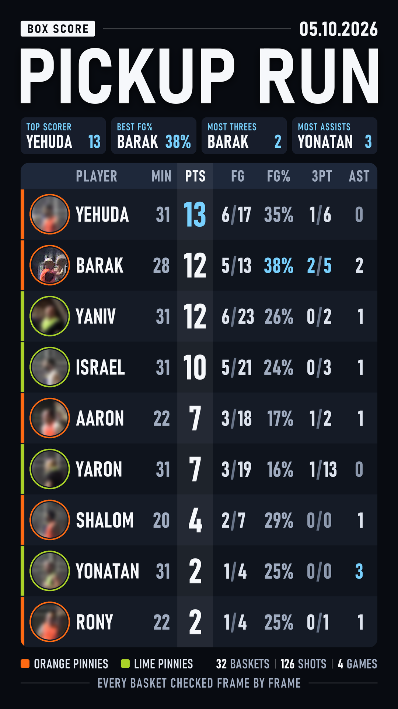
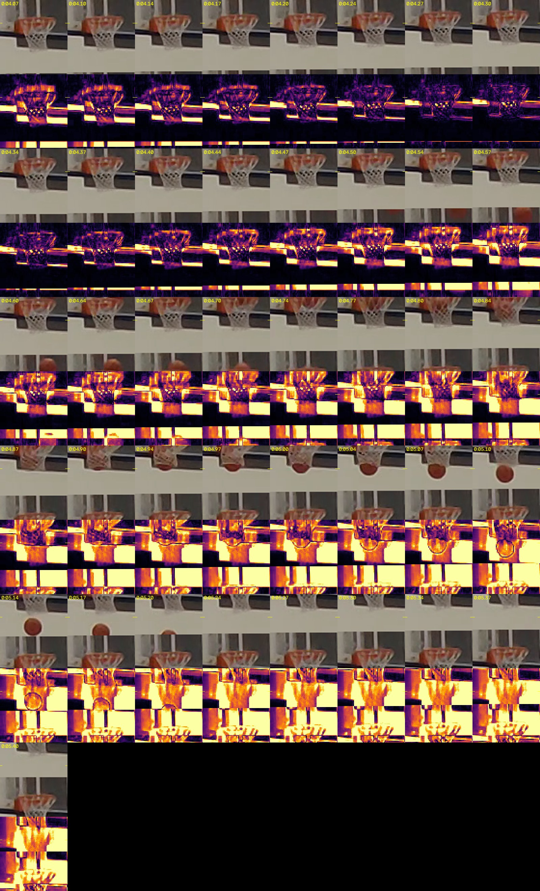

# courtside-ai

**Pickup game in. Every-basket recap, Top 10, box score and a coaching review out.**

Put a phone on a tripod at your pickup basketball game. A Claude Code agent runs this pipeline on the video and gives you back:

| Output | What it is |
| --- | --- |
| **Every-basket recap** | Every live basket, labelled `BUCKET 7  NAME`, with a slow replay of the good ones and a 6-second stat card per player at the end |
| **Top 10 countdown** | Landscape, plus a vertical 9:16 cut whose window *follows the ball*, with music |
| **Box score** | One vertical image: points, FG, FG%, threes, assists for everyone, leader chips on top |
| **Personal reel** | Every possession you touched, played to the end of the play, with `+2 PTS` / `ASSIST` pop-ups and your running line |
| **Coaching review** | Your drives analysed one by one, a slow-motion video per drive with stops and marks, and a "what to do next game" list tracked game to game |

Everything is checked by eye before it ships: the agent builds review pages, you confirm the names and the Top 10 picks, and every make gets a frame-by-frame look at the rim.

<p align="center">
  
  &nbsp;&nbsp;
  
</p>

The one-minute explainer (English and Hebrew), a full sample recap with faces blurred, and one English coaching clip are on the [releases page](https://github.com/bshireto/courtside-ai/releases).

---

## What you need

- **A paid Claude subscription with Claude Code.** The pipeline is a set of scripts, but the judgement calls (is that a make, who shot it, who passed) are made by Claude agents reading contact sheets. A full game is a few hours of agent time.
- **Any laptop with 16 GB of memory.** No graphics card. The one this was built on is a 2021 i7 with 4 cores. Player tracking on a 72-minute game takes about an hour, the renders about another hour; both run unattended, so start them in the evening.
- **Python 3.12+**, **ffmpeg** on the PATH, and **Node** (only for the Remotion explainer and the review workflows).
- **A phone on a tripod.** One fixed position, horizontal, 1080p/30. The camera guide is in `docs/camera_position.html`.

```
python -m venv .venv
.venv/Scripts/pip install -r requirements.txt          # torch (CPU), ultralytics, openvino, opencv, scikit-learn, pillow
yolo export model=yolo11s.pt format=openvino           # one-time: the person detector, into pipeline/models/
```

---

## How it works, question by question

### How does it know there was a basket?

It never trusts one signal.

1. **Motion in the net zone.** `hoop_features.py` crops the rim of every hoop out of every frame and measures motion and ball colour inside the net zone. `shot_candidates.py` turns the spikes into candidates. This is deliberately loose: hundreds of candidates per game, most of them false.
2. **Two independent reviewers per candidate.** `wf/verify_shots.js` gives each candidate to two Claude agents that see a 30 fps strip of the rim and a wider context strip, and answer make / miss / unclear with the shooter's description. A disagreement goes to a third agent.
3. **A sweep for what the motion missed.** `wf/sweep_shots.js` reads every 45-second window of the game and logs every attempt it sees, made or not. `merge_makes.py` reconciles the two routes on release time.
4. **The net has to move.** A ball dropping *behind* the net lights up a difference image exactly like a make, and reviewers call it a make. `net_strands.py` measures whether the net strands themselves went dark: a real make swings the net for 4+ frames, a ball behind it does not. `net_swing.py` is the coarser version of the same idea.
5. **Rim truth is by frame, never by vote.** `rim_check.py` renders every 30 fps frame around the rim moment, tight and upscaled, next to a difference-against-empty-rim row. A make is the ball going *inside* the net outline and leaving through the bottom. Every make that will be shown gets this look before the render. In the first game two of the top five "makes" were rim-outs that two reviewers had agreed on; that is where this rule came from.

### How does it tell a two from a three?

At the release, not at the rim. The exact release frame is found by stepping back from the rim moment to the moment the ball leaves the hands (reviewers place it about a second late if you let them). Then `feet_check.py` draws the 3-point arc, mapped once per camera position in `game.json`, over the shooter's feet in that frame, and the flight time is a sanity check: release to rim of 1.1 s or more is a long shot, 0.6 s or less is at the rim.

### Who scored, and who assisted?

`wf/attribute_shots.js` gives every make to two independent reviewers who describe the scorer, the passer and the play in one line, with a skill score and a team-play score. Disagreements go to a tie-breaker. An assist is a pass that leads directly to a made basket within about 4 seconds with at most one dribble by the scorer. A lob the scorer catches and finishes is an assist, never also a missed shot.

### How does it recognise players?

`track_players.py` runs YOLO11 (OpenVINO, CPU) with ByteTrack over a 5 fps frame dump. `players.py` embeds every detection with DINOv2 and groups the tracks into identities, then `naming_page.py` builds a page with one photo set per person and a name field. You type the names once; `players.py learn` trains a classifier and stores each person's crops, so the next game starts already knowing the regulars.

Things that broke and what replaced them: appearance clustering mixes players in the same pinnies, so names are never taken from clusters alone; in a crowded half court the tracker ids jump between people, so `roster_page.py` builds the naming page from clean stills instead; and when the user shows up in different clothes, `user_clf2.py` combines the embedding with clothing colours (precision 0.96, recall 0.93 on the second game).

### How are misses counted?

From the sweep and the attribution pass: every attempt a reviewer sees is logged with its shooter, so the box score carries FG made/attempted, 3PT made/attempted and the percentages, not just points. Only live play counts: warm-ups, shootaround in breaks, a flip right after a basket, a putback after a foul call and a lone shot to settle possession are all excluded, by checking the play context around every shot. In make-it-take-it the restart tells you: the scoring team keeps the ball.

### How does the vertical cut follow the ball?

A 9:16 window shows less than half of the wide shot, so a fixed crop lost the passer and the three-point shooter. `vfollow.py` is a virtual camera: a focus path per clip (`data/vpaths/<id>.json`), smoothed, with lead room toward the basket. `wf/follow_paths.js` has one reviewer per clip mark where the ball is through the live play and the replay, and run `vfollow.py check` until the framing sheet is clean. `render_vertical_follow.py` cuts the live window (864x1080, pans in x) and the replay (640x800, pans in x and y, half speed) straight from the source. The YOLO ball boxes are useless for this: a lamp is detected as the ball in most frames.

### What does the coaching review do?

From the personal reel, `analysis/make_sheets.py` decodes each possession into contact sheets (wide at 2 fps, tracked at 5 fps, 10 fps release strips). One vision agent reviews each possession, three syntheses (shot selection, mechanics, off-ball) and a head-coach pass produce the report, and a skeptic agent re-watches the frames behind every claim before anything is written. The drives get their own pass (`analysis/workflows/drive_analysis.js`): which side was open from the defender's stance and raised hand, the angle past him, where the help stood, and which hand reached for the ball.

Each drive becomes a video (`analysis/make_drive_video.py`): real speed with no text, slow motion that pauses at each key moment, one short sentence per stop with one mark added at a time, the real speed again, a simulation still of the better choice, and the sentence to say to yourself. Text never shares the screen with motion. The format spec is `analysis/DRIVE_VIDEO_BRIEF.md`.

---

## How to run it

The pipeline is driven by a Claude Code **skill**: `skill/basketball-recap/SKILL.md` is the step-by-step procedure the agent follows, with the non-negotiable rules learned from three games at the top. Install it as a skill in your Claude Code config, point it at a game video, and run it step by step in a session:

1. **Setup** - ffprobe, 1 fps contact sheets, camera moves, hoop pixel positions into `game.json` (schema in `pipeline/bbconfig.py`), a `CONTEXT.md` briefing for the reviewers (`examples/goren_run/CONTEXT.md`).
2. **Frames and signals** - 5 fps frame dump, hoop features, shot candidates, shot strips, player tracking (unattended, about an hour).
3. **Makes** - verify + sweep workflows, merge, net-swing and strand tests, live-play windows, rim check by eye.
4. **Players** - embed, naming page, learn.
5. **The user** - touches, shots, assists, reel clip windows.
6. **Stats** - minutes, points, FG, 3PT, assists per player.
7. **Render** - recap, Top 10 (list shown for approval first), vertical follow-the-ball cut, personal reel, stat cards, box score.
8. **QA** - decode check, sample frames of every output, phone copies.

Every script reads the game folder from the `BB_GAME` environment variable. The workflow files under `pipeline/wf/` run with Claude Code's Workflow tool and must stay LF-only.

---

## Open issues

Two things are not solved, and you should know before you start:

- **The workflow is not nailed yet.** The skill is a procedure written from three games, and the agent still sometimes prompts the wrong step. On the November run it asked for the scorer's name basket by basket, when the right move is one naming page for everyone and attribution from the shots afterwards. Expect to steer it; read the skill before a run and correct it when it drifts.
- **The judgement calls need the premium models.** Make / miss votes, shooter attribution, the ball path for the vertical cut and the coaching review were all done with the top-tier Claude models, not Sonnet; Sonnet got makes and shooters wrong too often to be worth the saving. On a Claude subscription that means a full game is spread across several sessions as the usage limits reset, and the workflows need resuming (`RESUME.md` in each game folder, `resumeFromRunId` for a workflow that stopped mid-way).

## Sharing a game outside the group

Your teammates did not sign up to be on the internet. Two tools make a public copy of any output:

- `pipeline/blur_faces.py <in> <out> --keep-user` blurs every face except the user's (face detector on every frame, plus the head zone of every tracked person, plus the stored "is this the user?" model to leave yours sharp; when unsure it blurs). Works on videos and on single images.
- `BB_BLUR_OTHERS=1 python pipeline/stats_poster.py` renders the box score with every photo blurred except the user's.

## Honest limits

- It is a workflow, not an app. A game is an evening of laptop time plus a few hours of agent time, and you confirm names and Top 10 picks on pages it builds.
- The camera matters more than the code. One fixed position, the whole arc in frame, the rim against a plain background. Filming lengthwise from under a basket makes the far rim 15 pixels wide and unreadable.
- Reviewers get fooled by balls behind the net, by heads in front of the rim and by late release frames. The rules in the skill exist because each of those happened.
- Player recognition is as good as the clothes: a new shirt means a short labelling round.
- The coaching review is written for its player (in Hebrew, in the original) and is the least finished part.

---

## History

- **July 2026** - a close-up clip of a jump shot and one question to Claude: what is wrong with my form?
- **23 September** - first full-game recap. Two of the top five "makes" were rim-outs. The frame-by-frame rule is born.
- **7 to 9 October** - second game: Top 10, the vertical cut that follows the ball, the box score poster.
- **9 to 13 October** - the coaching review: 13 drives, simulations, read-then-watch videos.
- **6 to 8 November** - a 94-minute run across 8 videos and 8 camera positions, 14 players who swapped shirts between games, 39 baskets on 120 attempts; recap, Top 10, box score and reel rendered overnight.

Built with Claude Code (Claude Fable). The changelog in `docs/CHANGELOG.md` records what each game taught the pipeline.

---

## Repo layout

```
pipeline/        the game pipeline (python) and the reviewer workflows (wf/*.js)
analysis/        the coaching-review tools and workflows
skill/           the Claude Code skill that runs it all, step by step
docs/            changelog, camera placement guides, research report, edit style guide
examples/        one game config and reviewer briefing (the November run)
explainer/       Remotion source of the explainer video
```

## Licence and credits

MIT for the code in this repo. It depends on [Ultralytics YOLO11](https://github.com/ultralytics/ultralytics) (AGPL-3.0), DINOv2 (Meta, Apache 2.0), OpenVINO, OpenCV, scikit-learn and Pillow. The explainer's music is "Funky Chunk" by Kevin MacLeod (incompetech.com), Creative Commons: By Attribution 4.0.
